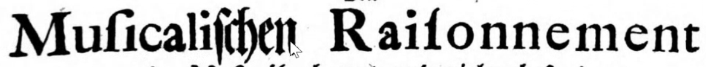

# General

* "broken" vs ~continuous fonts (or "printed" vs "handwritten"/"curved")

# Fraktur

* check German prints: they MIX antiqua and fraktur **even in the same word!**

  
  Source: https://imslp.org/wiki/Der_General-Bass_in_der_Composition_(Heinichen%2C_Johann_David)

* check fraktur of different languages: Sorbian, Latvian, Danish...

* print IS NOT **HANDWRITING!** – it needs much more depth...
  * kurrentschrift

* Fonts: https://www.peter-wiegel.de/fonts2.html

* Ligafraktur – automatic mapping: https://www.ligafaktur.de/Startseite.html
